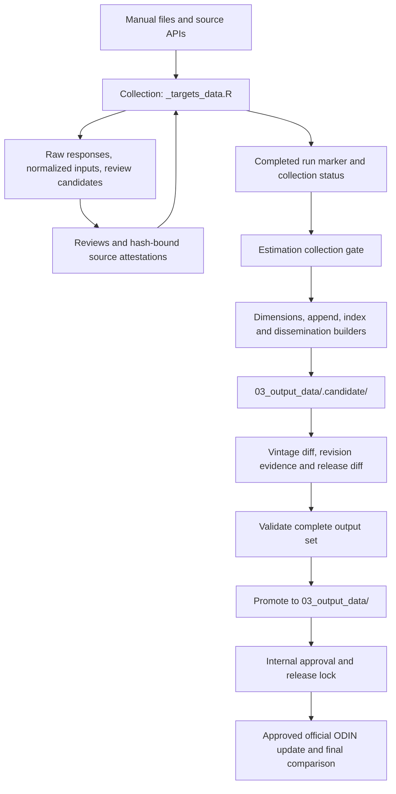

# SPI pipeline architecture

The active workflow separates source acquisition from statistical estimation.
Both graphs use `{targets}` and run from the repository root. The graphs have
separate stores so collection tasks do not share target metadata with scoring.
For the current update and outstanding approvals, see
[202611 status](update-status-202611.md).

A preliminary sandbox can produce review evidence before the collection and
vintage gates pass. It is a separate execution mode: its outputs do not
establish that normal estimation or publication is authorized.

## Collection graph

Entry point: `_targets_data.R`; store: `_targets_data/`.

The graph loads `config/params.R` and `config/source_registry.R`, marks the
run as started, then executes source-specific tasks. Major groups include:

| Group | Tasks and artifacts |
|---|---|
| Public API/cache collectors | PIP release and comparability; World Bank country/OECD/population/GDP snapshots; JMP cached sheets and quality file; OECD SDG data; UN SDG D3 and CRVS/legislation/finance inputs |
| Manual checkpoints | WDI metadata, IGME and ILO extracts, IMF workbooks, ODIN files, and other registry inputs |
| D4.1 | Eight input workbooks, manual-review validation, derived annual files, normalized catalogue companions, refresh cache, and collection manifest |
| Annual review builders | NADA URL evidence/review, EMPL national-sources evidence, CNIN/FINA overrides, and GSBP desk/manual review |
| Reporting | Review candidates and their history, `collection_status.csv`, `collection_status.md`, and `collection_run.json` |

The `source_type` and `expected_vintage_rule` fields describe how each source
is checked. A manual source needs its bytes attested; a release-based source
needs valid provenance and its recorded hash. A recent modification timestamp
is not evidence of a current source release.

`collection_state = "complete"` means reporting finished. It can coexist
with blocking rows. Conversely, a zero-blocking CSV from an older run is not
valid evidence for a later run that is still `started`.

### Refresh controls and network behavior

- `run_downloads` controls only the opt-in D4.1 catalogue refresh, which
  requires World Bank network access for its internal catalogue source.
- Other collectors can fetch missing/stale data even with that flag false.
  They preserve source-specific raw responses and provenance/cache identities.
- `refresh_nada_urls` controls the NADA URL refresh; default behavior and
  reviewer evidence are documented in the user guide.
- PIP collection resolves a release for the configured PPP base unless a
  release lock pins an approved release.
- Cached failures, unknown geography codes, schema drift, changed hashes,
  and invalid manual years stop the relevant task rather than becoming
  evidence of a missing observation.

See the [runtime inventory](source-runtime-audit.md) for source locations.

## Estimation graph

Entry point: `_targets.R`; store: `_targets/`.

`load_params()` reads the collected World Bank country snapshot; estimation
requires that snapshot instead of loading a live country list. Registry-driven
file targets and their content digest feed consumers so changed source bytes
invalidate affected calculations. `collection_gate` checks:

1. Source IDs and unique rows match the current registry.
2. The run is complete and its run ID and parameter hash match the report.
3. The report hash and run-marker self-hash match their recorded identities.
4. There are no blocking source rows.

A release lock, when present, is verified before estimation writes candidates.
The dimension targets score D1.5, D2, D3, D4, and D5; append builds `spi_data`,
and index construction builds `spi_index`. File-writer targets create CSV,
Stata, quantile, treemap, Databank, SPL, and revision-evidence outputs.
Target values in the store and written files are distinct dependencies.

ODIN annual files are shared file inputs for D2.2 and D4.3. Their scoring
chains are separate from the non-ODIN parts of D2 and D4. `odin_status` is
read separately from scoring parameters; changing a label is not proof that
a new official release was supplied. The official release record is checked
separately before promotion.

## Candidate files and promotion

`params$estimation_write_dir` is `03_output_data/.candidate/`.
Each writer owns its files; the directory is not wiped on every run because
that would delete outputs of targets that were already up to date.

The gates are separate:

| Check | Purpose |
|---|---|
| Vintage baseline manifest | Verify the approved previous indicator/index files against their recorded hashes |
| `vintage_diff` | Report refreshed-history changes and stop unapproved frozen-history changes |
| `revision_report` | Summarize indicator, index/rank, and new-reference-year effects |
| `release_diff` | With a release lock, restrict changes against the approved provisional output archive |
| `output_manifest` | Validate expected files, non-empty content, schema/key coverage, and ODIN status |
| `promote_output_set()` | Copy the complete allowed set to `03_output_data/`, with backup/rollback on copy failure |

Promotion replaces designated current outputs after validation. It is not a
manual copy from `staging/`, and it is not an external publication action.
Do not describe the multi-file copy as a single atomic filesystem operation.
An interrupted run requires inspection and a controlled rerun.

The output manifest lists the vintage and expected files. A provisional
run includes `PROVISIONAL_ODIN.md`; an official run requires an approved
`ODIN_release.json`, and successful promotion removes the provisional marker.
Preserve historical published vintages and approved archives separately.

## Directories that are easy to confuse

| Directory | Meaning |
|---|---|
| `staging/` | Legacy compatibility outputs; not consumed as the active candidate set |
| `03_output_data/.candidate/` | Current estimation working outputs; may contain a blocked or partial run |
| `03_output_data/` | Last promoted output set; a directory's existence alone does not identify its vintage |
| `03_output_data/releases/` | Approved archives created when a release lock is written |
| `replication/spi-rep/preview-p0p1/` | Retained 24 October 2026 preliminary review snapshot |
| `replication/.scratch/` | Repository-local working sandboxes and temporary intermediates |
| `01_raw_data/4.1_SOCS/collection/staging-*` | Source-refresh working directories; distinct from the root legacy `staging/` |

## Preview and vintage-replication tools

The tools under `tests/replication/` copy code into an isolated sandbox and
use source-file links or protected copies. Outputs and sandboxes stay inside
the repo. Preview and ODIN rehearsal runs override the collection and vintage
approval gates **inside the sandbox**; they retain blocking findings in
reports. Never copy those overrides into `R/` or treat the result as a passed
normal gate.

`run_replication.R` instead rebuilds the configured 2024 vintage for
comparison with the published fixtures and a differential reference. See
[replication instructions](../replication/README.md) and the
[test interpretation guide](user-guide.md#7-interpreting-test-results).

## Release integrity and limits

The release lock records non-ODIN source artifacts, relevant provenance
sidecars and collection controls, the PIP release, and archived output hashes.
Its schema, internal digest, and detached `.sha256` record are checked. These
are integrity checks, not an external digital signature or independent
approval authority. Human source/method decisions remain necessary.

Lock creation requires a complete promoted set and must follow provisional
approval. The later official ODIN transition must pass both the source
release-record contract and the output-level allowed-change comparison.
See [ODIN guidance](odin-delayed-update.md), including its current annual-file
hash restriction. Historical rehearsals do not replace validation against the
actual final source files and current code.
